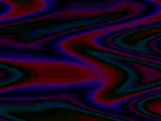
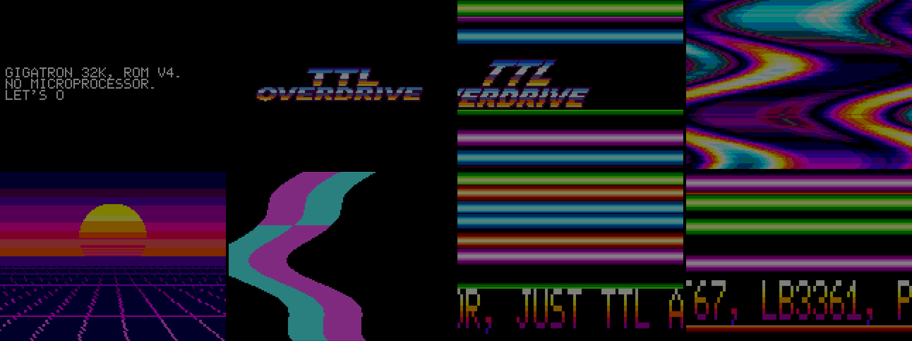

# TTL OVERDRIVE

A demo for the [Gigatron](https://gigatron.io), the computer built from 1970s TTL chips
with no microprocessor. It runs on a 32K Gigatron with ROM v4: 1 minute 42 seconds of
copper bars, a full-screen plasma, a synthwave sunset, a twister and a greetings
scroller, on an original 4-channel soundtrack, with the blinkenlights on the drums.



**Watch it with sound: https://youtu.be/jgWpHFhubRg**



## Run it

**On a real Gigatron** (32 KB, ROM v4): send `overdrive.gt1` with the Loader, for example
with an Arduino running [BabelFish](https://github.com/kervinck/gigatron-rom/tree/master/Utils/BabelFish):

```sh
python3 gigatron-rom/Utils/sendFile.py overdrive.gt1
```

Plug a speaker into the audio jack: the sound is 4 bits and not very loud.

**In an emulator**: any Gigatron emulator that loads GT1 files, set to ROM v4 and 32K.

## How it works

The Gigatron has no video chip: the ROM's native code sends every pixel to the VGA port
itself, and user programs run in an interpreted 16-bit virtual CPU (vCPU) in the time
left over. In the video mode used here (two scanlines out of four), that is about 1,400
vCPU instructions per frame, about a dozen per pixel row. Nothing in this demo is
computed per pixel.

- **The videoTable does the work.** For each of the 120 pixel rows, the ROM reads which
  memory page to show and a horizontal offset. Every effect is a choice of page and offset
  for each row, written in one pass from the top of the frame so that it stays ahead of
  the beam.
- **Strips.** 32 full 256-byte pages are filled at the start of each scene, natively,
  with the ROM's `SYS_SetMemory`: plasma colour cycles, twister slices at 32 angles,
  grid lines at 24 depths. The plasma is two sliding tables picking a strip and an offset
  per row. It runs at 60 frames per second, as does the twister.
- **Offsets add up.** The offset in the videoTable is relative to the row above, so a
  wobbling logo needs a correcting offset on the row below it. Rows on full strip pages
  can take any offset; rows on the 160-byte visible part of a code page must be at 0.
- **`SYS_Sprite6` as a blitter.** The ROM's sprite routine copies 6 bytes per call at native
  speed; the copper bars are drawn with it.
- **Music.** A small tracker player in vCPU assembly drives the ROM's 4 software sound
  channels: patterns with transposition, envelopes (the waveform clip level doubles as a
  volume), frame-rate arpeggios, vibrato and noise drums. It takes 18 % of a frame.
- **Memory.** The screen takes most of the 32 KB. Code lives in the 96 bytes past the end
  of each pixel row, and read-only data in the visible part of rows that are never shown.

## Build

```sh
gmake GLCC=/path/to/glcc ROM=/path/to/gigatron-lcc/gigatron/roms/v4.rom
```

You need [glcc](https://github.com/lb3361/gigatron-lcc) (the C compiler and vCPU
assembler for the Gigatron) and GNU make. `tools/song.py` writes the music
(`src/song.s`), `tools/gfx.py` the graphics and tables (`src/gfx.s`, needs Pillow and the
Arial Black font); both outputs are in the repository.

`tools/gtshot.c` is a headless, cycle-exact Gigatron (core from `Docs/gtemu.c` in
[gigatron-rom](https://github.com/kervinck/gigatron-rom), BSD license) that records the
VGA picture, the 4-bit sound and the LEDs: `gmake video` writes `media/overdrive.mp4`.

| Path | |
|---|---|
| `src/main.c` | timeline and scenes |
| `src/fx.s` | videoTable commits, strip generators, per-row effect loops |
| `src/player.s` | music player |
| `src/demomap.py` | memory map for the glcc linker |

## Credits

Directed by [storagebits](https://github.com/storagebits).
Greetings to Marcel van Kervinck and Walter Belgers for the Gigatron, at67, lb3361 for
glcc, Phil Thomas, and everyone on the [Gigatron forum](https://forum.gigatron.io).

MIT license, see `LICENSE`.
